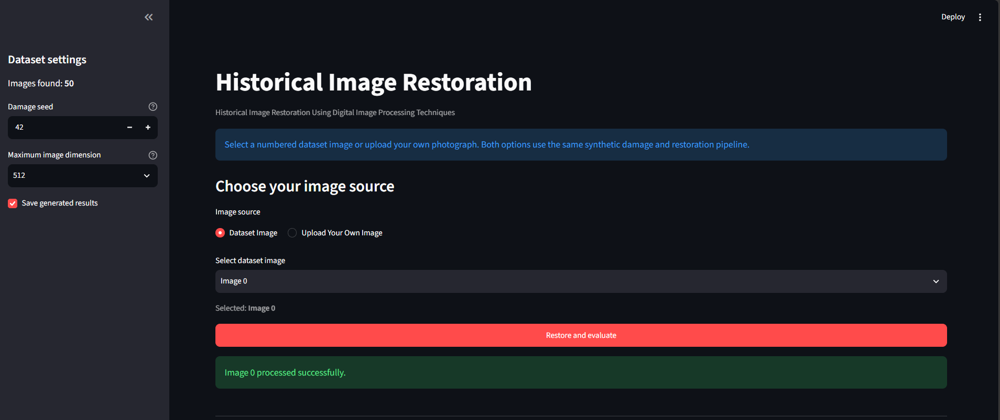
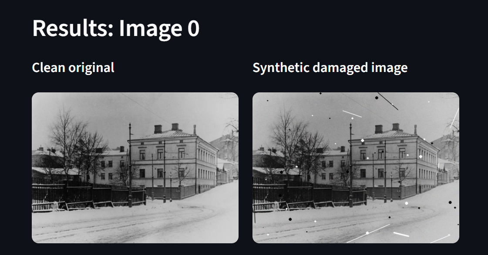
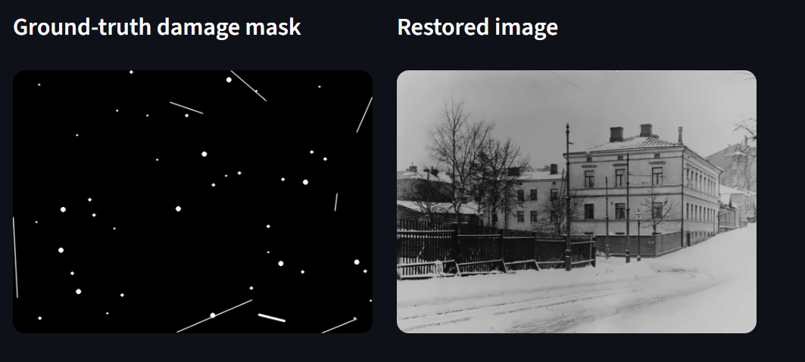
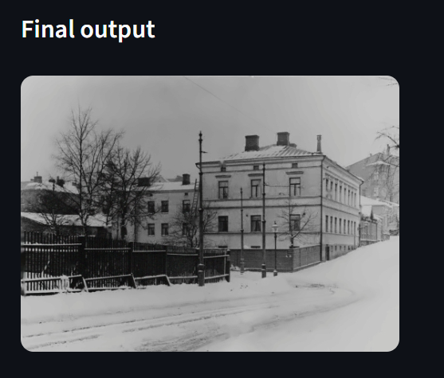
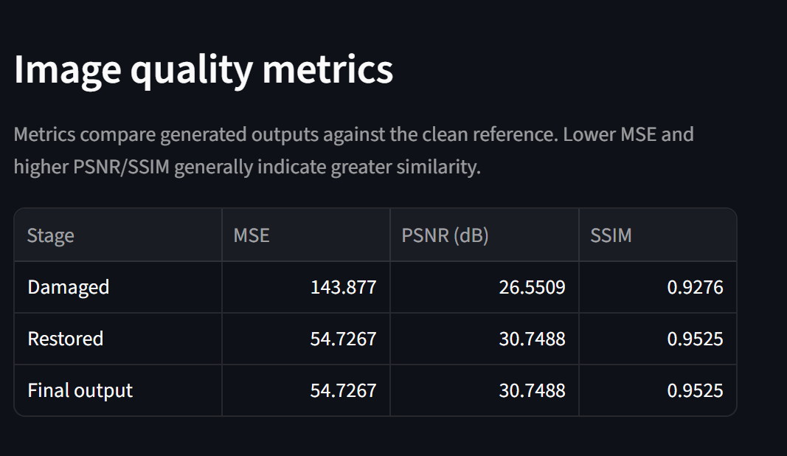

# Historical Image Restoration

**A Digital Image Processing project for restoring synthetically damaged historical photographs using Python, OpenCV, and Streamlit.**

<p align="center">
  
  
  
  
</p>

## Overview

Historical photographs preserve valuable cultural and historical information, but their quality can deteriorate due to scratches, dust, noise, and fading.

This project provides an interactive application to study image degradation and restoration using digital image processing techniques. It supports a collection of 50 historical images and allows users to examine the original image, simulated damage, damage mask, restored image, and final output.

## Features

- Interactive Streamlit interface
- Selection of numbered dataset images
- Upload option for testing individual photographs
- Reproducible synthetic damage generation
- Damage mask visualization
- Mask-based image restoration using OpenCV
- Image quality evaluation using MSE, PSNR, and SSIM
- Downloadable restored images and metric reports
- Optional saving of generated results

## Application Preview

Screenshots of the application and restoration results will be added here.

<!-- Add screenshots after creating the screenshots folder.
Example:

-->

## Technology Stack

| Technology | Purpose |
|---|---|
| Python | Application and processing logic |
| OpenCV | Image processing and restoration |
| NumPy | Image array operations |
| Pandas | Metric tables and CSV reports |
| Streamlit | Interactive user interface |

## How It Works

1. **Image selection:** Load a clean image from the dataset or upload an image.
2. **Synthetic degradation:** Generate controlled damage using a configurable seed.
3. **Damage mask:** Obtain the mask associated with the generated damage.
4. **Restoration:** Apply the implemented mask-based restoration pipeline.
5. **Quality evaluation:** Compare the generated outputs with the clean reference.
6. **Results:** View, save, and download the restored image and metric report.

## Image Quality Metrics

- **Mean Squared Error (MSE):** Measures the average squared pixel difference. Lower values generally indicate less pixel-wise error.
- **Peak Signal-to-Noise Ratio (PSNR):** Measures reconstruction quality in decibels. Higher values generally indicate greater similarity to the reference.
- **Structural Similarity Index (SSIM):** Compares image structure, luminance, and contrast. Higher values generally indicate greater structural similarity.

Metrics should be interpreted together with visual inspection. A higher score does not necessarily mean that every historical detail has been recovered.

## Project Structure

```text
historical-image-restoration/
├── app.py
├── restoration.py
├── requirements.txt
├── README.md
├── .gitignore
├── dataset/
│   └── original/          # Local dataset images
├── results/               # Generated outputs
└── screenshots/            # Repository preview images
```

The dataset and generated results are excluded from the public repository by default. Add them locally before running the application.

## Installation and Usage

### Prerequisites

- Python installed on your computer
- Git
- The project's dataset images in the expected local directory

### 1. Clone the repository

```bash
git clone https://github.com/insanjeevisevalive/historical-image-restoration.git
cd historical-image-restoration
```

### 2. Create a virtual environment

```bash
python -m venv .venv
```

Activate it on Windows PowerShell:

```powershell
.\.venv\Scripts\Activate.ps1
```

### 3. Install dependencies

```bash
python -m pip install -r requirements.txt
```

### 4. Add the dataset

Place the clean images inside:

```text
dataset/original/
```

Ensure that the dataset is used in accordance with its source and licensing terms.

### 5. Run the application

```bash
python -m streamlit run app.py
```

Streamlit will provide a local URL to open the application in your browser.

## Current Scope and Limitations

The current evaluation pipeline uses synthetic damage and its associated mask. Therefore, the reported metrics evaluate restoration of generated damage against a clean reference image.

The upload option uses the same demonstration pipeline on an uploaded image. This does not by itself establish that the system can automatically detect and remove all pre-existing scratches, stains, or fading in real historical photographs.

Restoration quality depends on image content, damage patterns, and the limitations of the implemented algorithms.

## Future Improvements

- Automatic detection of real-world image damage
- Improved preservation of fine details and textures
- Evaluation on additional datasets and degradation types
- Exploration of deep-learning-based restoration
- Expanded experiments and reproducible quantitative comparisons

## Research and Attribution

Dataset source, licensing details, research references, and experimental results will be documented here after verification.

## Author

**Project:** Historical Image Restoration Using Digital Image Processing Techniques

## Application Preview



## Restoration Results

The restoration pipeline is demonstrated through the following stages.

### Original and Synthetic Damage



### Ground-Truth Mask and Restored Image



### Final Restoration Output



## Image Quality Evaluation


